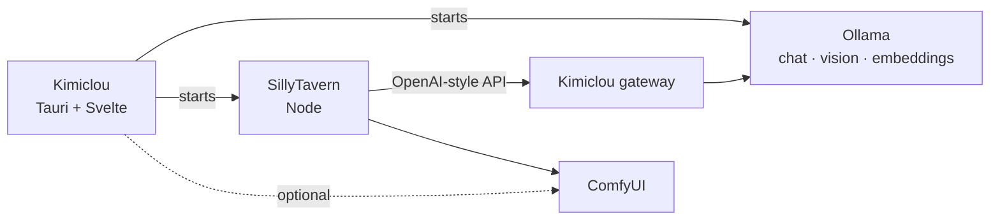

<div align="center">


# Kimiclou

**A local roleplay studio: SillyTavern, Ollama and ComfyUI install and tune themselves to your GPU, and run in a single window.**

[](https://github.com/AndreyVerse/Kimiclou/releases/latest/download/Kimiclou.exe)

[](https://github.com/AndreyVerse/Kimiclou/releases)
[](https://tauri.app/)
[](https://svelte.dev/)
[](https://www.rust-lang.org/)
[](#requirements)
[](LICENSE)

[Download](https://github.com/AndreyVerse/Kimiclou/releases/latest/download/Kimiclou.exe) · [Guide](docs/guide.md) · [Features](#features) · [Build from source](#build-from-source) · [License](#license)


</div>

## ⭐ What makes it different

Kimiclou is not another chat UI and not a Docker recipe. It is a single portable `Kimiclou.exe` that installs SillyTavern, Ollama and ComfyUI, picks models for **your** GPU and VRAM, and puts its own gateway between SillyTavern and the model. The gateway gives characters a live state, relationships, repetition protection and a roleplay layer that a plain SillyTavern + Ollama setup does not have.

A local SillyTavern usually needs Node, Git, Python, Ollama, model tags and a dozen GPU-dependent settings. Kimiclou handles it:

- **setup wizard** detects the GPU and VRAM, picks models that will actually run and downloads a portable runtime;
- **launcher** starts Ollama, SillyTavern and optionally ComfyUI in the background and opens SillyTavern in the app window;
- **settings window** manages models, context size, image recognition, image generation, tags, personality traits and fine-tuning.

No Docker, no cloud account. Chats, characters, memory and images stay on your disk.

## Features

| | |
|---|---|
| **Everything in one click** | Portable Node, SillyTavern, Ollama and models: no admin rights, nothing is installed system-wide. |
| **Catalog for your hardware** | Only models that fit the GPU are shown (CUDA, Vulkan for AMD and Intel, or CPU). Context is capped automatically when it does not fit VRAM. |
| **Memory** | Vector memory on Ollama embeddings plus SillyTavern lorebooks and World Info. |
| **Vision** | A separate model describes images you drop into the chat. |
| **Images** | Optional ComfyUI with a checkpoint catalog: characters send art on request, via the wand button or `/imagine`. NVIDIA only. |
| **Speech** | Windows voices out of the box and Kokoro inside SillyTavern. |
| **Living characters** | Trait intensity, live state (affection, trust, energy, irritation), relationships between characters, repetition protection. |
| **Roleplay layer** | Quests, trading, NPCs, skills, XP and combat on top of the chat. |
| **Fine-tuning** | Text LoRA (exported to an Ollama model) and image LoRA (kohya sd-scripts) on your own datasets. |
| **SillyTavern updates** | Updated in place without losing characters or chats. |
| **Russian and English** | The UI follows the system language and can be switched at any time. |

## How it works



SillyTavern does not talk to Ollama directly. It talks to a small local gateway inside Kimiclou. The gateway adds the characters' live state, repetition protection, prompt budget calculation and roleplay hooks, then forwards the request to Ollama. Every service listens on `127.0.0.1` only.

## Installation

**[Download Kimiclou.exe](https://github.com/AndreyVerse/Kimiclou/releases/latest/download/Kimiclou.exe)** (portable exe) · [all releases](https://github.com/AndreyVerse/Kimiclou/releases)

1. Put `Kimiclou.exe` into any folder you can write to. There is no installer: the app is one portable exe and does not need admin rights.
2. Run `Kimiclou.exe`.
3. Follow the wizard: it downloads the runtime (~1.7 GB), the selected models and SillyTavern.

The `Kimiclou.exe` checksum is listed in the release description.

> Since 1.5.0 the app checks GitHub releases for updates itself, downloads the signed archive and restarts after confirmation. A 1.2.x installation needs one manual update: its update button still points to the old host.

By default, models live in the `models\` folder next to the app. The wizard lets you pick another folder and suggests existing model stores: for example, an Ollama store in `%USERPROFILE%\.ollama\models` is used as is and nothing is downloaded twice. The `KIMICLOU_MODELS_ROOT` environment variable points a new installation at a shared model store.

### Requirements

- Windows 10/11 x64
- 8 GB of RAM minimum, 16 GB recommended
- ~20 GB of disk space for the runtime, SillyTavern and one chat model
- A GPU is optional: NVIDIA (CUDA) or AMD and Intel with Vulkan; small models run on the CPU
- Internet for the first setup; after that everything works offline

## Build from source

Node.js 20+, [pnpm](https://pnpm.io/), Rust stable (MSVC) and WebView2 are required. The sources for this version are in the `Kimiclou-<version>-src.zip` release asset: unpack it and run the commands below.

```bash
pnpm install
pnpm check                       # svelte-check
cargo test --lib --manifest-path src-tauri/Cargo.toml
pnpm tauri dev                   # development window (Vite on 127.0.0.1:5343)
pnpm tauri build --no-sign       # portable exe: src-tauri/target/release/kimiclou.exe
```

Signed builds take the update key from the environment: `TAURI_SIGNING_PRIVATE_KEY` (the key contents) or `KIMICLOU_SIGNING_KEY_PATH` (path to the file), see `tools/build-signed-release.ps1`. In a fork, generate your own key with `pnpm tauri signer generate` and replace `plugins.updater.pubkey` and the release URLs in `src-tauri/tauri.conf.json`.

### Character pack

The public release does not ship Hololive cards: the rights to the characters and art belong to their owners, and the AGPL license does not cover them. This is deliberate: third-party portraits do not go into the public repository.

Put your own cards into the `characters` folder next to `Kimiclou.exe`: SillyTavern-format `*.png` files and an optional `tags.json`. On every start the cards are added to SillyTavern; existing ones are never overwritten.

Will profiles live in `characters/will.json` and are copied once into `data/traits.json`; your edits are not overwritten. The catalog of every character's goals, values and boundaries is `characters/CHARACTERS.md`. Both files and `tags.json` are part of the release sources; PNG cards are not.

### Project layout

```
src/                    Svelte UI
  Launcher.svelte       main screen: status, model, quick actions
  Wizard.svelte         first-run setup
  Settings.svelte       models, VRAM, vision, images, tags, traits
  Training.svelte       text LoRA
  ImageTraining.svelte  image LoRA
  lib/i18n.svelte.ts    RU and EN strings, language detection
src-tauri/src/          Rust: installation, runtime, gateway, SillyTavern and ComfyUI integration
src-tauri/theme/        theme and SillyTavern localization patches
src-tauri/moonlit/      bundled Moonlit Echoes theme (third-party)
tools/                  release script and live test probes
```

## Privacy

Kimiclou never sends your chats, characters or images anywhere. The network is used only to download the runtime and models from official sources and to check for updates.

## License

Kimiclou is free software under the [GNU AGPL v3.0 or later](LICENSE). Third-party components and their licenses are listed in [THIRD-PARTY.md](THIRD-PARTY.md); [NOTICE](NOTICE) states the attribution that must accompany the program.

The source of every version is in the same release: `Kimiclou-<version>-src.zip`. The public repository ships the exe, updates and that archive; the development history stays in the private repository.

Why AGPL instead of a permissive license: Kimiclou ships SillyTavern extensions that import its modules, patches SillyTavern sources at runtime and bundles the Moonlit Echoes theme (AGPL-3.0) into the exe. That makes it a derivative work of AGPL code, so it stays under AGPL.

At runtime the app downloads and patches **[SillyTavern](https://github.com/SillyTavern/SillyTavern)** (AGPL-3.0); the patched files remain AGPL-3.0. **ComfyUI** (GPL-3.0) is an optional separate process; **Ollama** and **Node.js** are MIT. Models are not part of the repository and keep their own licenses; check each model page.
